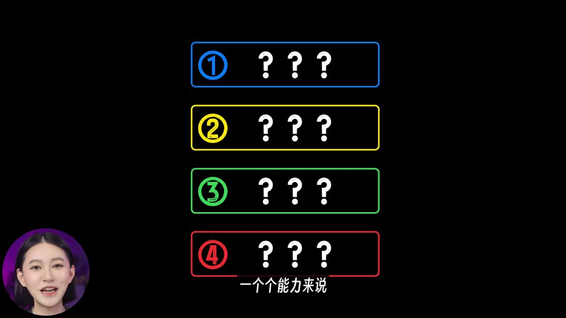
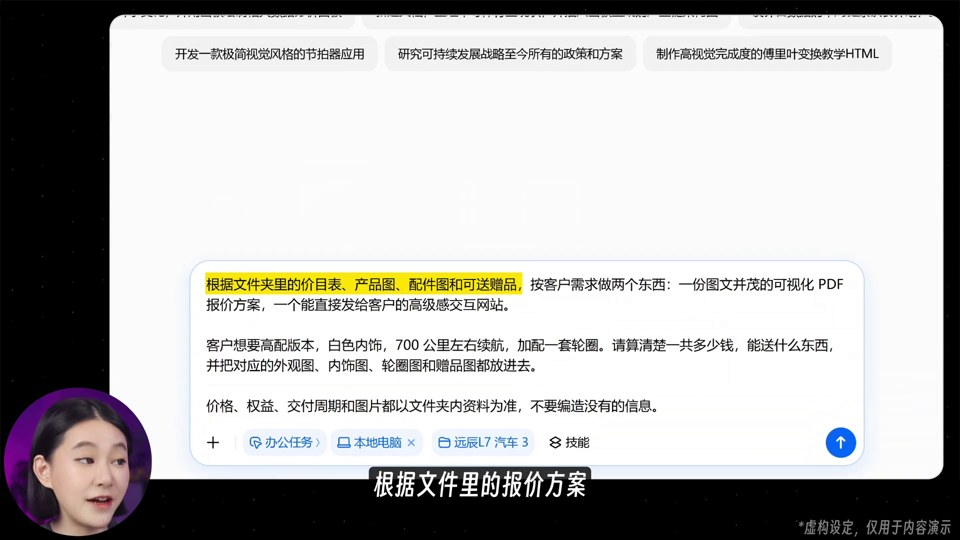
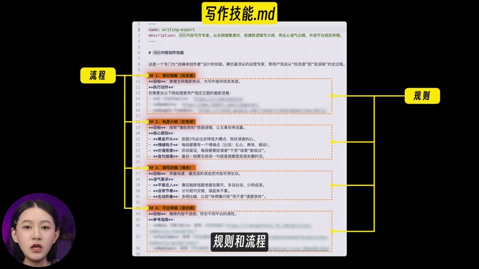

# 风格：秋芝-豆包｜场景驱动的 AI 实操教学

参考素材：`03 秋芝-豆包.mp4`，8 分 10.52 秒，1920×1080，30 fps。分析日期：2026-10-20。

本目录沿用[小Lin说](../小Lin说/README.md)的解析逻辑：**风格精华 → 实测数据 → 可复用方案 → 画面证据与数据**。分析对象仅为这条视频，不代表作者所有作品。视频中的产品能力、效果和“99%”是原片的表达，不是本报告验证的产品结论。

## 一、这条视频的精华

**一句话：主播负责建立信任，卡通情境负责解释需求，真实录屏负责证明过程，成果展示负责兑现承诺。**

1. **用工作收益开场。** 00:03 的卡通员工、00:06 的“豆包员工”、00:15 的巨大“99%”，先把工具升级翻译成“能替你干活”。不是先报功能菜单。
2. **四项能力构成反复回来的导航。** 本地电脑操作、浏览器操作、技能使用、定时任务，以蓝、黄、绿、红编号卡区分。开头用问号制造未揭晓状态；每进入一章就揭开一项；结尾把四项重新放回同一画面，并展示组合关系。
3. **每个能力尽量用职业任务说明。** 汽车销售对应报价、网页、合同；行政采购对应比价表和购物车；轻食店对应宣传视频。先让观众理解“这活我也会遇到”，再给输入和操作。
4. **实操段采用固定舞台。** 黑底、大尺寸圆角软件窗口、左下圆形主播、底部短句字幕。观众不用反复寻找主讲人和内容区。
5. **长提示词不要求一口气读完。** 01:27–01:36、03:00–03:15 把口播正在解释的部分依次涂黄；06:15–06:36 则用局部压暗和橙色虚线框引导视线。
6. **操作之后必须给可见成果。** 报价 PDF、交互网页、Word 批注、比价表、购物车、轻食广告和技能教程，都有结果画面。输出是故事的回报点。
7. **主播回归承担换气与评价。** 开头承诺、案例之间、03:36 的互动和结尾总结采用大幅真人画面；不在每个鼠标操作后都切回主播。
8. **把抽象概念翻译成情境。** 03:51–04:06 用人和机器人的对话表现“重复交代要求”；再把这个问题收束到“写作技能.md”。概念卡是情境的答案。

## 二、实测与抽样数据

| 指标 | 结果 | 口径与限制 |
| --- | --- | --- |
| 总时长 | 490.52 秒 | 容器时长；视频轨 490.50 秒 |
| 主播作为主要画面 | 25/164 个样本，约 15.2% | 每 3 秒一帧人工标注；含真人旁加手机或文字，不含左下圆头像；不是精确出镜时长 |
| 场景变化候选 | 64 个，约 7.83 个/分钟 | FFmpeg 缩小到宽 320 后，scene > 0.25；不是所有切镜或动画变化 |
| 候选边界间隔中位数 | 4.60 秒 | 含片头、片尾边界；不是人工逐镜头统计 |
| 最长未触发检测区间 | 48.23 秒 | 不等于画面静止；滚动、高亮和鼠标动作可能不触发阈值 |
| 原片混音整体响度 | -13.53 LUFS | 原始音轨运行 FFmpeg loudnorm 测量 |
| 响度范围 / 真峰值 | 3.90 LU / +1.70 dBTP | 解码后混音的测量值，不是建议母带目标 |
| ASR 汉字密度 | 约 258 字/分钟 | 未校对转写中的 2111 个汉字 ÷ 总时长；英文、漏字和错字会影响结果，不能当精确口播语速 |

与小Lin说目录一样保留量化依据，但不套用其“47 次变化/分钟”“音乐抬升 15–25 dB”等数据。本次没有分离音乐、人声，也没有完成逐事件音效听辨，因此不提供 BGM 曲名、BPM、重击次数或音乐抬升幅度。

## 三、可复用方案

这是本次提出的制作方案，**不是已经获批的品牌变体**。

**主循环：现实任务 → 手工做法的麻烦 → 选择资料/输入指令 → 软件执行 → 展示交付物 → 主播评价 → 导航进入下一章。**

建议沉淀六个可复用组件：

- **能力导航卡**：四行编号；未讲项降低亮度、文字用问号；当前项显亮；结尾全部揭晓。
- **实操讲解舞台**：黑底 + 大软件窗口 + 左下圆头像 + 底部字幕；缩放时只动软件窗口。
- **任务情境卡**：卡通角色 + 职业标签 + 真实材料缩略图；把人物关系和材料来源说明白。
- **提示词跟读高亮**：句子按语义分组，讲到哪一组亮哪一组；不要整页同时染色。
- **成果验收卡**：先展示完整输出，再放大一处足以证明成功的细节。
- **总结组合卡**：把已讲能力重新集合，突出能力之间的组合，而不是只重复四个名称。

**画面气质：**黑色信息舞台和紫色真人背景交替；黄/荧光绿强调收益和关键词；章节编号以蓝黄绿红区分。颜色是观察得到的视觉关系，具体色值、字体和动画时长见[复用制作规范](复用制作规范.md)，其中参数均为建议，不声称是原工程参数。

## 四、怎么查阅

| 路径 | 内容 |
| --- | --- |
| [逐段拆解.md](逐段拆解.md) | 叙事结构、时间点、画面机制及可复用理由 |
| [复用制作规范.md](复用制作规范.md) | 布局、字幕、动画、脚本模板和剪辑检查项 |
| [数据/测量说明.md](数据/测量说明.md) | 方法、误差、自动转写限制及复测命令 |
| 拆解/全片概览 | 全片每 3 秒一帧，9 张联系表 |
| 拆解/逐秒画面 | 全片 491 张秒级采样排为 21 张联系表，附机器转写片段 |
| 拆解/重点拆解 | 25 张带秒数文件名的关键截图 |
| 数据 | 转写 JSON/TXT、候选切点、主播抽样 CSV、节奏 JSON、响度日志与处理脚本 |

原始视频保留在用户本地，本目录提交解析与截图，不重复上传原片。逐秒联系表是取样索引，并非对所有帧逐帧审阅的证明；机器转写仍有明显识别错误，正文依据画面字幕对关键术语作了核对。
