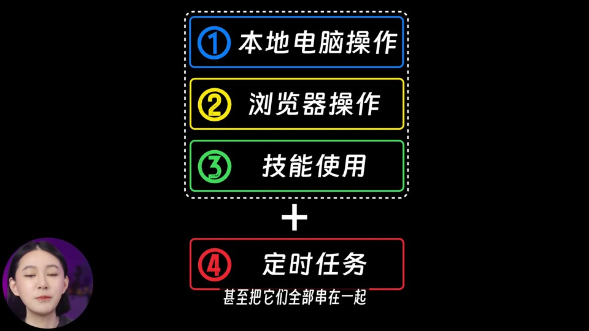
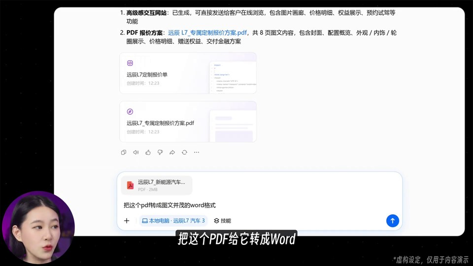
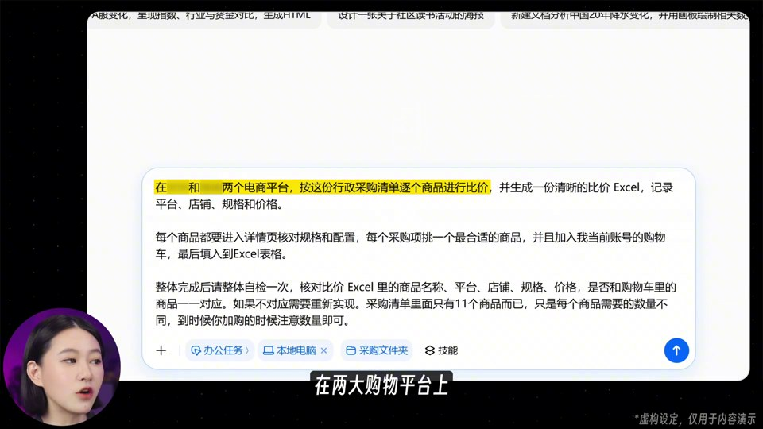
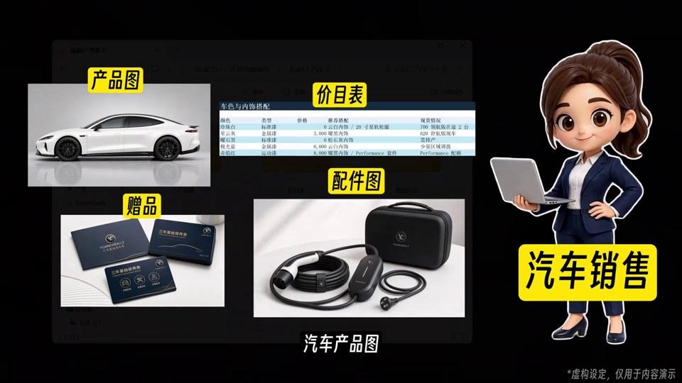
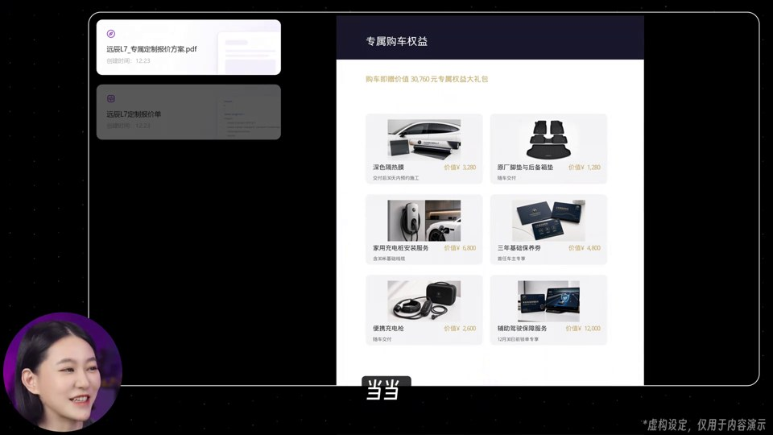
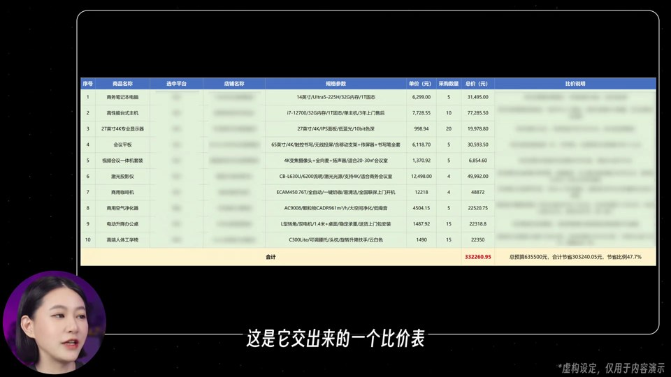
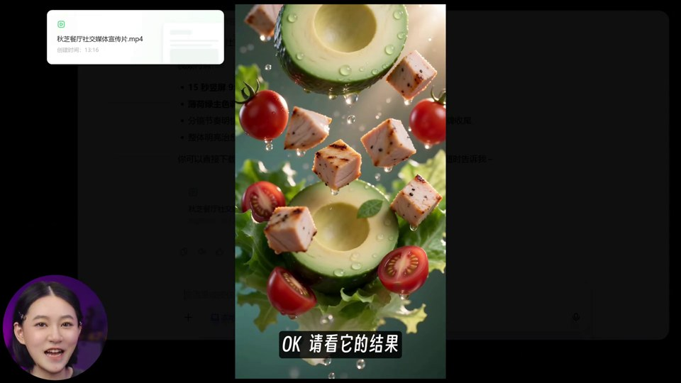
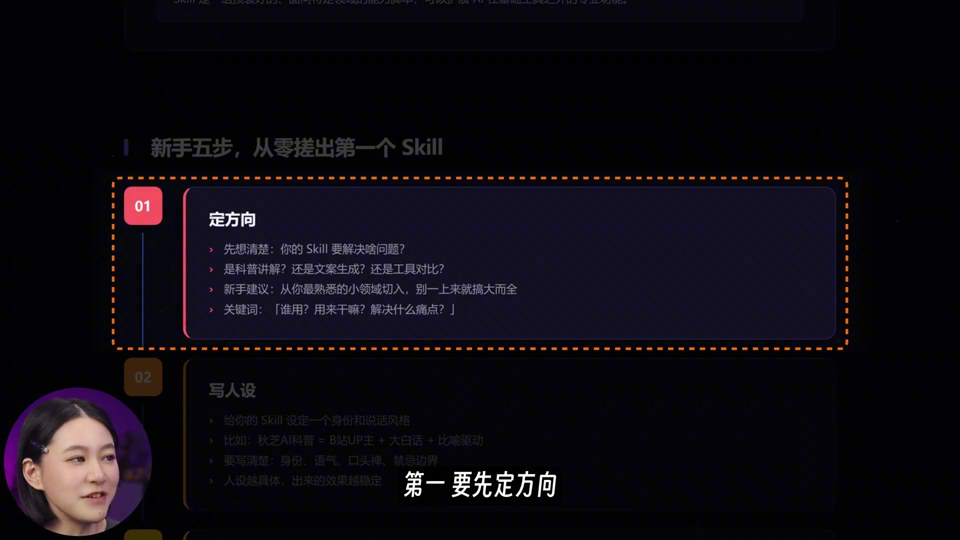
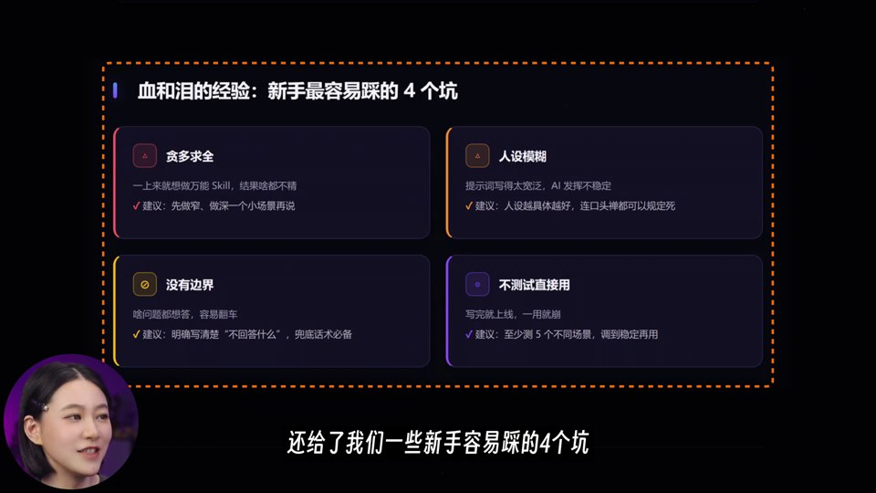

# 秋芝-豆包：逐段拆解

时间边界按秒级画面、原片字幕和机器转写综合整理，约有 1–2 秒误差。截图文件名对应原片秒数。

## 1. 全片叙事安排

| 时间 | 内容与画面 | 功能 | 可复用的做法 |
| --- | --- | --- | --- |
| 00:00–00:20 | 卡通员工 → 产品化“员工”概念 → 真人 + 巨大 99% | 认知反差、收益承诺、关注提醒 | 先讲角色变化和使用收益，再解释功能；数字承诺属于营销表达，复用时需有依据 |
| 00:20–00:43 | 安装入口 → 普通模式/办公模式对照 → 真人提问 | 建立最少必要前提 | 用两列对照解释区别，逐步增加条目，而不是堆满参数 |
| 00:43–00:50 | 四项问号导航，揭晓本地电脑操作 | 给长视频一张地图 | 保留未知项，制造后续观看预期 |
| 00:50–01:19 | 汽车销售、材料包、客户手机需求、普通手工回复 | 搭建场景和痛点 | 角色、文件、客户需求三件事先齐全 |
| 01:19–01:48 | 选资料文件夹 → 提示词高亮 → 输出 PDF/网页 | 证明输入到输出的因果链 | 清晰显示材料入口和关键指令，省略无信息等待 |
| 01:48–02:28 | 展示报价与网页 → 客户发合同 → 转 Word、批注修改 | 成果兑现并追加一个连续任务 | 不换案例也能扩展能力，用户容易理解工作闭环 |
| 02:28–02:44 | 创建/查看/修改总结 → 导航揭晓浏览器操作 | 完成一章并升级场景 | 总结只抽象已看见的行为 |
| 02:44–03:35 | 行政采购情境 → 比价指令 → 登录接管 → 比价表与购物车 | 演示跨网页任务 | 保留接管环节，过程可信；两类结果并列展示 |
| 03:35–03:48 | 真人提议点赞评论、检查作业 | 情绪换气和互动 | 把互动接到刚演示的能力上，而不是插无关口号 |
| 03:48–04:23 | 导航第三项 → 人与机器人反复交代 → 技能文件、规则流程标注 | 解释抽象概念 | 先展示重复劳动，再给概念名称和结构 |
| 04:23–05:11 | 技能菜单 → 轻食店宣传需求 → 竖屏成片结果 | 展示已有技能的实际收益 | 用“交付成片”而不是只展示 AI 回答文本 |
| 05:11–05:24 | 真人评价 → 无技能/有技能并排 | 价值对比 | 把复杂提示词与简短调用放在同一画面，让省事可见 |
| 05:24–06:05 | 搜索、下载、安装、调用作者技能，输出教程 | 将内容延伸到可用资源 | 展示完整入口链；这是资源导流结构，不等同于通用产品步骤 |
| 06:05–06:54 | 深色教程网页，五步骤逐项框选、示例和新手坑 | 对输出二次讲解 | 屏幕滚动跟随章节，以压暗和框选隔离当前信息 |
| 06:54–07:24 | 让 AI 生成并安装简单技能，提到创建技能能力 | 从看结果到再实践 | 给观众一个较小的练习，再提示更复杂任务的入口 |
| 07:24–07:45 | 第四项定时任务 → 多例子 → 四能力组合 | 快速完成地图并提升到组合应用 | 简单项短讲，复杂项长讲，不平均分配时长 |
| 07:45–08:10 | 真人留作业 → 奖杯 → 四项回顾 → “用一两个”与关注 | 回扣承诺、降低行动门槛 | 结尾把“全部学会”落到“先用一两个” |

从时间分配看，技能章节约 216 秒，接近全片 44%；定时任务与组合总结约 21 秒。可借鉴的是按解释难度分配时长，不能机械做成四等份。

## 2. 关键画面机制

### A. 同一导航卡承担三种状态

00:45 先看到四个编号与问号；02:36 第一项显亮；07:42 将前三项框为一组，以加号连接第四项。它不是装饰性目录，而是内容状态记录器。

### B. 用三层画面维持讲解陪伴

主信息层是软件窗口；陪伴层是左下角圆形头像；语言层是底部字幕。圆形裁切降低对录屏的遮挡，黑色留边给头像和字幕留位置。主体窗口会随内容改成窄文档、手机、左右对照或宽网页，不应固定拉伸所有素材。

### C. 提示词是演示的一部分

约 03:00–03:15，指令高亮随口播向后推进。观众能分清任务、输出格式、约束和附加操作。关键不是“加黄色”，而是高亮范围与当前解释对应。

### D. 卡通图用于解释角色和麻烦

汽车销售、行政人员、机器人让职业身份和重复劳动易懂；真实资料和软件录屏承担操作证据。不能把卡通情境当作软件真实执行结果。

### E. 成果页留出观看时间

PDF、网页、表格、成片对应不同成果形态；镜头需要展示能辨认的细节，而不是把所有结果都做成一闪而过的图标。约 05:00–05:09 的竖屏广告属于被演示的输出，不应把其内部镜头语法误当全片主风格。

### F. 复杂页面用暗化隔离当前块

正文原本是密集页面，当前块保持可见，周围压暗，橙色虚线框做边界。页面滚动后继续复用同一套强调方式。缩略图并不能让观众读完正文，实际视频需局部放大。

## 3. 节奏的判断

全片宏观节奏是“承诺快、任务具体、操作连续、成果停留、章节重置”。细节层靠高亮、滚动、局部缩放、列表揭晓与主播手势维持变化。

因此 64 个自动场景变化候选只描述较大的画面差异，不能用它宣称全片每 7.7 秒才变化一次。相反，也没有证据声称这条片达到小Lin说的每 1.3 秒变化一次。

## 4. 与小Lin说解析的关系

| 维度 | 小Lin说参考目录 | 本片观察 |
| --- | --- | --- |
| 核心舞台 | 人物关系、事件与信息图反复出现 | 四能力地图与操作窗口反复出现 |
| 证据材料 | 新闻截图、文档、图表 | 指令、软件操作、实际交付物 |
| 角色表达 | 人物徽章与外号 | 圆形真人讲解头像、职业卡通角色 |
| 重点强调 | 金属/毛笔大字、大数字、透视图表 | 黄色涂亮、荧光底标签、虚线框、局部压暗 |
| 适合复用的任务 | 事件解释、关系梳理、数据论证 | AI 工具教学、办公流程、案例演示 |

学习共同的“稳定舞台 + 状态变化 + 证据配合口播”，具体视觉组件按本片建立。
